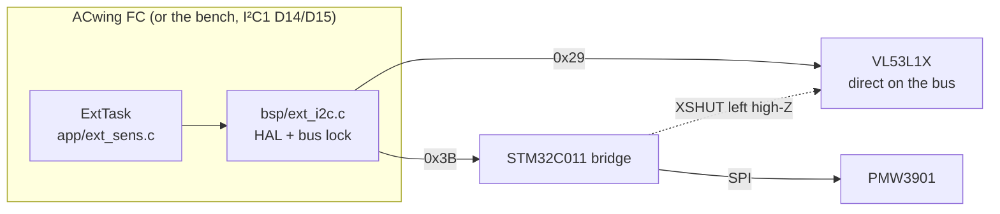
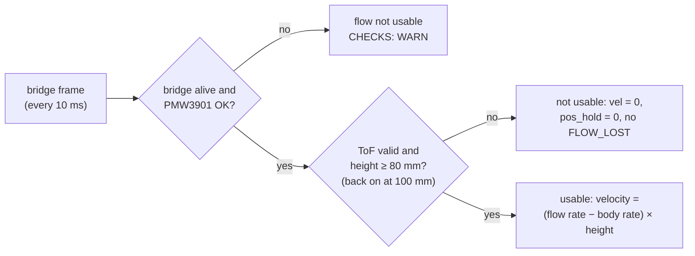

# Sensors and expansion boards

| Source | Part, bus | Driver | Available on |
|---|---|---|---|
| Barometer | LPS22DF (X-NUCLEO-IKS4A1) or LPS22HB (ACwing FC rev A), slave 1 of the LSM6DSV16X **sensor hub**, 50 Hz, in the same FIFO | `imu_lsm6dsv16x.c`, model from WHO_AM_I. Optional: if it is missing, the IMU starts without it | bench and FC |
| ToF height | VL53L1X at 0x29 on the Qwiic bus (ACwing Flow), long mode, 33 ms (30 Hz) | `vl53l1x.c` (from ST's ULD, BSD-3) | ACwing Flow |
| Optical flow | PMW3901 behind the STM32C011 bridge at 0x3B, 100 Hz motion burst | `flow_bridge.c` on the FC; bridge firmware in [`01 - FLOW_FW`](https://github.com/ACwing-UAV/ACwing_FW/blob/main/01%20-%20FLOW_FW/README.md), same register map (checked by its host test). An unprogrammed bridge leaves FLOW at 0 in CAPS | ACwing Flow |
| Gyroscope, accelerometer | LSM6DSV16X, I²C1 on the bench (SPI on the ACwing FC), FIFO at 960 Hz | `imu_lsm6dsv16x.c` | bench and FC |
| Compass | LIS2MDL (bench) / IIS2MDC (FC), slave 0 of the sensor hub, 100 Hz, in the same FIFO | `imu_lsm6dsv16x.c` | bench and FC |

The barometer and the compass are read by the **LSM6DSV16X sensor hub** and land
in the same FIFO as the gyroscope and the accelerometer. They share the IMU time
base, and the MCU needs no extra bus transaction for them. Sensor bits in CAPS
are set only for the parts found at run time.

## Expansion bus (Qwiic)

The ExtTask probes the devices at boot and every 5 s while one is missing, so
the Flow board can be plugged in later; a new sensor bit makes the AppTask send
CAPS again. It polls them every 10 ms. After 50 consecutive bus errors a
device is declared lost and probed again. Every bridge frame goes up, even
without new motion, so that the FC knows the sensor is alive on the ground
too. The ToF is read by the FC directly, so it works whether the bridge is
programmed or not. The bridge firmware is described in
[ACwing Flow bridge](flow-bridge.md).

## Altitude estimate

The barometer and the ToF feed the [altitude Kalman filter](../theory/altitude-kf.md)
(`filters/altitude_kf/alt_est.c`). It runs in the ImuTask: prediction at
240 Hz from the IEKF attitude and the accelerometer, baro update at 50 Hz, ToF
update at 30 Hz. In short:

- **without ToF** the baro bias cannot be observed, so it is frozen and the
  height follows the baro;
- **with ToF** the baro drift is estimated and the height follows the floor;
  a ToF jump (stepping onto a table) is gated, and the floor is re-anchored
  after 0.5 s;
- **below the ToF minimum range** (about 40 mm; landed, the lens is 11 mm
  above the floor) the reading means "on the ground".

The same logic runs on the **models with and without GNSS**. Only the mode
entered at the end of the takeoff changes: POS_HOLD with GNSS or FLOW,
ALT_HOLD otherwise.

## Optical flow below its minimum height

The flow sensor works from 80 mm
(`APP_FLOW_MIN_H`). With the drone on the ground the lens is about 11 mm
above the floor, so on the ground, at lift-off and in the last centimetres of
a landing the bridge rejects every sample (no surface features) and the flow
is invalid by design. Below that height the FC:

- marks the flow **not usable**: no velocity, so NAV `vel` and the ground
  speed read 0, and `fc_setpoint().pos_hold` = 0 (level attitude, no
  position hold);
- judges **FLOW_LOST only** in the air, above 0.15 m on the ToF, and never
  during TAKEOFF or LAND;
- in CHECKS, **on the ground**, checks only that the bridge and the sensor
  answer (OK, with the quality as value). The quality rule (WARN < 50 %)
  applies in the air.

The height comes from the ToF. The flow becomes usable again 20 mm above the
limit; without a valid ToF reading the flow is not used.

The flow velocity uses about 0.0205 rad per count (42° / 35 px), with the axis
signs `APP_FLOW_SIGN_X/Y` in `app_config.h`. They follow the frame-C2
mounting and still have to be confirmed on the first board.
