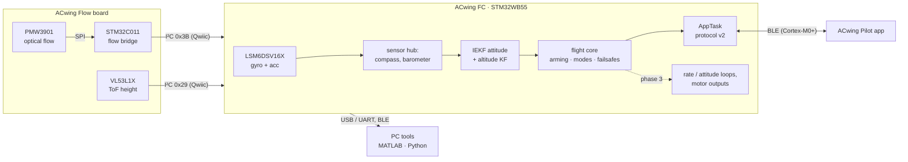

  <picture>
    <source media="(prefers-color-scheme: dark)" srcset="00%20-%20Brand/ACwing_logo_white.png">
    
  </picture>

# ACwing firmware

**ACwing** is an open project for small multirotors. Both its hardware and its
software are designed in the project:

- **Hardware.** A modular set of PCBs: a universal flight controller
  (**ACwing FC**), a 1S power board, and GNSS and optical-flow expansions.
  They are in the hardware repository,
  [ACwing_HW](https://github.com/ACwing-UAV/ACwing_HW).
- **Software, in this repository:**
  - the firmware of the flight controller and of the ACwing Flow bridge;
  - the PC tools used to develop, calibrate and validate it;
  - the **ACwing Pilot** app.

The first target is the **ACwing 1S mini drone**: 4 × brushed coreless 8520
motors on 1S. Its first milestone is **attitude control**.

| ACwing part | What it is | Where |
|---|---|---|
| ACwing FC | flight controller: STM32WB55, LSM6DSV16X IMU, barometer, compass, BLE, two 4-in-1 ESC links | [hardware repository](https://github.com/ACwing-UAV/ACwing_HW) |
| ACwing ESC 1S | 1S power board: 4 brushed motor stages, current sensor, USB-C charger | hardware repository |
| ACwing GPS, ACwing Flow | expansions: GNSS + compass (outdoor); optical flow + ToF height (indoor) | hardware repository |
| **FC firmware** | attitude IEKF, altitude Kalman filter, flight core (arming, failsafes, TAKEOFF/LAND), protocol v2 for the app, telemetry over USB and BLE | `00 - FC_FW` |
| **Flow firmware** | STM32C011 bridge: PMW3901 optical flow → I²C target for the FC | `01 - FLOW_FW` |
| **PC tools** | live viewer, capture, calibration, validation, in MATLAB and Python | `02 - Tools/00 - Matlab`, `02 - Tools/01 - Python` |
| **ACwing Pilot** | flight, telemetry, settings and calibration app (web/PWA, iOS, Android) | `02 - Tools/02 - App` |

## The system at a glance

## What makes this repository more than firmware

- **Validation against the reference filter.** The firmware streams the
  *exact* inputs of every filter call. The PC replays them through the MATLAB
  reference and checks that the embedded estimate is the same, up to float32
  vs double. This was done on the board for the original equations and for
  every embedded improvement, as described in
  [Validation against the reference](tools/validation.md).
- **Two equivalent toolchains.** Every PC tool exists in MATLAB and in Python.
  The two give the same numbers on the same data, and their logs are
  interchangeable.
- **Host tests for the flight logic.** Failsafe timings, TAKEOFF/LAND against
  a vertical plant, the altitude filter, the drivers and the app protocol run
  on the PC under AddressSanitizer and UBSan. The frames they produce are
  decoded byte for byte by the app's own decoders.

## Status

| Phase | Content | Status |
|---|---|---|
| 1 | Embedded attitude estimation: IEKF on SO(3), multi-rate FreeRTOS pipeline, telemetry, PC tools, validation against the reference filter | **concluded**, validated on the board (≤ 0.003 σ against the reference) |
| 2 | BLE telemetry to the PC; ACwing Pilot app protocol v2: commands, parameters, calibrations, checks, app-link failsafe; altitude (baro + ToF) with TAKEOFF / LAND / HOLD; ACwing Flow bridge firmware | BLE **validated on the board**. Protocol v2, altitude and Flow bridge implemented and host-tested, **not yet run on the board** |
| 3 | Control: rate loop at 960 Hz, attitude loop at 240 Hz, motor power stage, thrust model in the estimators | planned |

Today the firmware runs on the ST evaluation kit, P-NUCLEO-WB55 with the
X-NUCLEO-IKS4A1 shield. The kit has the same MCU and the same IMU as the
ACwing FC. Motors are disabled (`MOTORS_ENABLE = 0`).

## Where to start

| I want to... | Read |
|---|---|
| find my way in the repository | [Repository structure](overview/repository.md) |
| understand the vehicle and its sensors | [Vehicle model and dynamics](theory/vehicle-model.md) |
| understand the attitude filter | [Attitude IEKF](theory/iekf.md), then [IEKF on the microcontroller](theory/iekf-embedded.md) |
| understand the altitude estimate | [Altitude Kalman filter](theory/altitude-kf.md) |
| see how the firmware is organised | [Architecture](firmware/architecture.md), API reference of the [FC](https://acwing-uav.github.io/ACwing_FW/api/fc/) and [Flow](https://acwing-uav.github.io/ACwing_FW/api/flow/) firmware |
| build and flash | [Building and flashing](firmware/build.md); for the Flow board, [ACwing Flow bridge](firmware/flow-bridge.md) |
| see the attitude live, record logs | [PC tools and live viewer](tools/pc-tools.md) |
| calibrate the magnetometer | [Magnetometer calibration](tools/mag-calibration.md) |
| validate the embedded filter | [Validation against the reference](tools/validation.md) |
| use BLE | [BLE telemetry](firmware/ble.md) |
| fly from the app, or work on its protocol | [ACwing Pilot protocol v2](firmware/protocol-v2.md) and the [handover](https://github.com/ACwing-UAV/ACwing_FW/blob/main/02%20-%20Tools/02%20-%20App/HANDOVER_FW.md) |
| know why something is the way it is | [Decisions](decisions/index.md) |
| fix a problem | [Troubleshooting](guides/troubleshooting.md) |
| change this documentation | [Writing the documentation](project/documentation.md) |

The theory pages give each equation in the form used by the code, with the
name of the file that implements it.

---

**Author:** Andrea Cirillo, ACwing firmware and PC tools.
